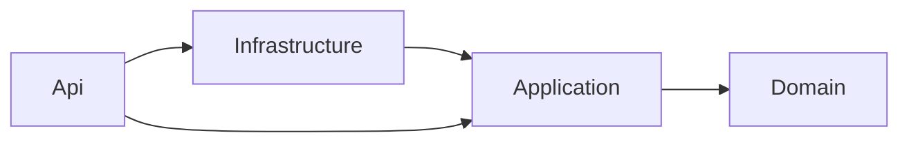

# 0001. Use a layered architecture for the API

- **Status:** Accepted
- **Date:** 2026-11-07

## Context

The domain is small, but its rules have safety consequences. A serialized part can't be installed
on two cars at once. A part at 80% of its life limit raises a warning, and a part at 100% is
blocked from install. These rules must be easy to find, easy to test, and impossible to bypass
from an HTTP handler or a SQL query.

We also know the data access will change: the parts search will be tuned with indexes,
projections, and server paging (see `docs/perf/`). That tuning must not affect the business rules.

Readers include reviewers new to the code base, so the dependency direction has to be obvious from
the project structure alone.

## Decision

We will split the API into four projects, with references that point inward only:

| Project            | Owns                                                                                      | May reference                  |
| ------------------ | ----------------------------------------------------------------------------------------- | ------------------------------ |
| **Domain**         | Entities, value objects, and invariants (life limit, single install). Pure C#.            | nothing                        |
| **Application**    | Use cases, ports (interfaces such as `IPartSearch`), request/response models, validation. | Domain                         |
| **Infrastructure** | EF Core `DbContext`, migrations, port implementations, SQL-specific query tuning.         | Application, Domain, EF Core   |
| **Api**            | Minimal API endpoints, DI composition, OpenAPI, ProblemDetails error mapping.             | all of the above, ASP.NET Core |

Rules that keep this lightweight:

- **No mediator library and no generic repository.** Each use case is a plain class injected into
  its endpoint. A port exists only where it pays for itself, such as for testing or for a
  query that needs SQL-specific tuning.
- **Reads can skip the domain model.** Query ports may project straight from EF Core to response
  DTOs (CQRS-lite), which is where the performance work happens. Writes always go through domain
  entities so the invariants run.
- **Enforced, not just documented.** Project references make an outward dependency fail to
  compile. [`LayerDependencyTests`](../../api/tests/RaceShop.UnitTests/Architecture/LayerDependencyTests.cs)
  also fails the build if EF Core, SqlClient or ASP.NET Core types leak into an inner layer.

## Consequences

- **Easier:** domain rules get fast unit tests with no database. Performance work stays inside
  Infrastructure. Swapping SQL Server would touch one project.
- **Harder:** more projects and more mapping code than an app this size strictly needs. A new
  feature can touch up to four projects.
- **Accepted on purpose:** a reviewer can see from the project structure where each kind of
  change belongs. That is worth the extra ceremony here.

## Alternatives considered

- **A single project organized by feature (vertical slices).** Less ceremony, and defensible
  for an app this size. Rejected because nothing would stop an endpoint from changing install
  records without running the life-limit rules. The boundary would depend on review alone.
- **Full Clean Architecture with a mediator, pipeline behaviors and generic repositories.** Adds
  indirection we don't need. Generic repositories also hide the queries we plan to tune.
